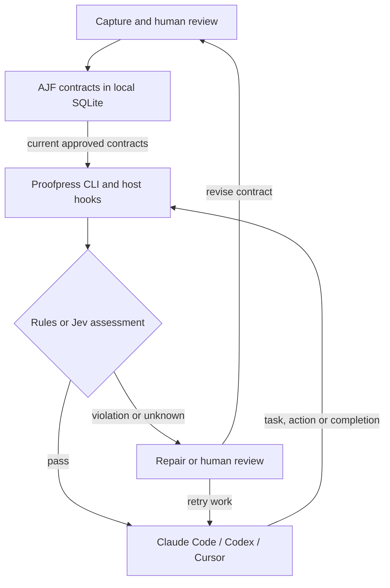

<p align="center">
  
</p>

# Proofpress

**Behavioral contracts for coding agents.**

**Stop silent failures in your coding agent.**

Everything is recorded. Agents still repeat the same mistakes. Proofpress turns
human steering and consequential agent decisions into reviewed behavioral
contracts: what to do, why, when it applies, and how to check that agents follow it.
Start with one developer, one project and a correction worth carrying forward
across Codex, Claude Code and Cursor.

- **Capture the choice and its boundaries.** Keep the rationale, evidence and conditions with the instruction.
- **Review the behavior before enabling it.** Approve the guidance, applicable checks and failure handling together.
- **Check at the right time.** Supply relevant context, check covered actions, and review declared artifacts at completion.
- **Recalibrate when conditions change.** Revise or withdraw a judgment; keep its history and stop reusing stale approvals.

[Website](https://proofpress.dev) · [Quick start](#quick-start) ·
[Architecture](#architecture) · [Enforcement](#enforce-judgments) · [Docs](#documentation)

## A correction becomes a behavioral contract

A judgment records a consequential choice with its reasons and limits. Add the
checks that should govern later work, review them together, and it becomes a
behavioral contract. For example:

> **Change the source schema. Regenerate the client.**
> **Why:** Direct client edits are overwritten by the next generator run.
> **Applies:** Changes to this project's API and generated client.
> **Checks:** Reject direct edits to `src/generated/*`; review the plan and delivery evidence against the judgment.
> **On failure:** Request repair, or pause for human review when evidence is missing.

An agent can draft the judgment and its checks from your correction or its own
work. You review the exact revision before it can govern later tasks. A judgment
can also remain advice-only; not every useful lesson needs a blocking check.

## Quick start

Run your agent's command from the project where you work. Requires macOS or
Linux and Git. The installer sets up Python, Proofpress, the project's
`.judgment/` store and the guidance for your agent. [Installation details](docs/INSTALL.md)

### Codex

```sh
curl -fsSL https://raw.githubusercontent.com/continuara-lab/proofpress-judgment/main/install.sh | bash -s -- --agents codex
```

### Claude Code

```sh
curl -fsSL https://raw.githubusercontent.com/continuara-lab/proofpress-judgment/main/install.sh | bash -s -- --agents claude-code
```

### Cursor

```sh
curl -fsSL https://raw.githubusercontent.com/continuara-lab/proofpress-judgment/main/install.sh | bash -s -- --agents cursor
```

The installer shows the project policy. Use it as shown or customize what the
agent may propose. Start a fresh session in the project and give your agent a task. The project
instructions tell it when to look up approved judgments and propose new ones.
[Commands for other agents](docs/AGENTS.md#install-by-agent)

When your agent proposes a judgment, review it in your terminal:

```sh
proofpress review
```

Choose a candidate from the numbered inbox. Read it, edit it if needed, then approve
or reject it. **You approve before reuse.** Capture is agent guidance, not an
automatic listener for every message.

## How it works

**Capture & review → Reuse → Learn → Recalibrate.** Governance spans the loop.
An approved judgment can guide later applicable tasks; observations can support
or challenge it; a new review can narrow, replace or withdraw it. In this local
CLI, Learn means recording sourced observations; Recalibrate means manually
reviewing revisions or withdrawals.

During reuse, the contract declares where to intervene: before execution,
before relevant actions, or at completion. The host connection supplies those
events and Proofpress applies the checks. No separate workflow configuration is
required. Coverage depends on the host and the controlled operation.

## Architecture



The contract is portable **AJF JSON**. The local **SQLite store** keeps immutable
versions, approvals and check receipts. **Host hooks** supply events; Proofpress
resolves current applicability and runs the declared **verifiers**. One connection
per host serves the project's approved contracts; adding a judgment does not
require installing another host hook.

[Architecture and storage](docs/ARCHITECTURE.md) · [Checks, host coverage and recovery](docs/BEHAVIOR.md)

### From reviewed judgment to behavior

| Stage | What happens | Boundary |
| --- | --- | --- |
| **Review** | You inspect the judgment, rationale, conditions and optional behavior together. | Approval covers the exact revision, including its checks. |
| **Before execution** | The project-local judgment inventory is evaluated using known facts and optional task criteria; relevant context is supplied before a declared plan check. | Semantic task matching can be wrong; uncertainty pauses. |
| **During execution** | Only matching action rules run, such as rejecting a direct edit to generated files. | These checks are deterministic; they do not call a model per tool action. |
| **Before delivery** | Declared delivery checks review actual files within the judgment's artifact paths, including new files and deletions. | Failed or uncertain checks keep delivery unapproved; repairs require rechecking. |

Hooks declare **when** to check; verifiers declare **how** to check. They belong to
the judgment. A host connection supplies events and honors the results.
[Architecture](docs/ARCHITECTURE.md) · [Behavior and examples](docs/BEHAVIOR.md)

### Deterministic and semantic checks

Proofpress combines deterministic rules with semantic judgment and behavioral
constraints. Both can belong to the same reviewed judgment:

| Type | How it decides | Example |
| --- | --- | --- |
| **Deterministic** | Apply an explicit built-in rule to known facts or actions. | Block direct edits to `src/generated/*`. |
| **Semantic** | Jev assesses the judgment together with context and evidence. | Does this plan incorrectly assume the service runs as a single instance? |

Semantic assessment handles meaning and context. Deterministic execution ensures
that a declared check runs and applies its result: allow, pause or request repair.
**Deterministically pausing when Jev does not pass does not make Jev's judgment
itself deterministic.** Semantic errors and uncertainty remain possible.

Built-in rules and semantic criteria are enough to try the core experience.
Custom verifier programs can be added later when a concrete use case needs them;
this release does not execute agent-generated verifier code.

### Draft checks when capturing a judgment

An agent can propose the checks alongside the judgment. After a correction such
as “change the source schema instead of hand-editing generated clients,” it can
draft applicability conditions, protected file patterns, a delivery criterion
requiring schema changes and regeneration evidence, and failure handling.

Here, **drafting a verifier means selecting built-in rules and their parameters,
and writing semantic check criteria**. Proofpress executes the supported checks.
The agent must ground paths, scope and intent in the actual project and correction;
missing information stays explicit rather than becoming a guessed constraint.

**Automatically draft; review with the judgment; enable only after approval.**
Capture creates a candidate. A human reviews the judgment and proposed behavior
together before it can govern later tasks. Not every captured lesson needs a
blocking check. [Example and supported declarations](docs/BEHAVIOR.md)

## Agent Judgment Format (AJF)

AJF is the portable JSON format for a judgment. Version `0.4-draft` adds optional
`applicability.task_criteria` and `behavior`: context, hooks, verifiers, artifact
coverage and failure handling. Existing 0.1–0.3 records remain readable and their
digests are unchanged. Advice-only records do not acquire checks automatically.

Most judgments are one JSON document. Built-in rules and semantic check criteria
need no additional code. This version **does not execute custom verifier scripts**.
Approvals, task sessions and check receipts remain local records; importing JSON
does not import authority.

[Format guide](docs/AJF.md) · [JSON schema](src/judgment_layer/ajf.schema.json) ·
[Judgment with behavior](examples/behavior-judgment.json)

## Import past sessions

Run the command for the agent whose local history you want to import. Each
command previews the last seven days and asks before saving excerpts locally.

**Codex**

```sh
proofpress history project --project . --agent codex
```

**Claude Code**

```sh
proofpress history project --project . --agent claude-code
```

**Cursor**

```sh
proofpress history project --project . --agent cursor
```

To turn the imported excerpts into candidates, use the separate extraction step.

```sh
proofpress consolidate --scope coding --model-assessment --all
proofpress review
```

Extraction sends excerpts to Codex, including when the source is Claude Code or
Cursor. Redaction is best effort. [Supported transcripts and import guide](docs/INTAKE.md)

## Enforce judgments

Start with a judgment that declares its own checks. This prints a synthetic
example to adapt; capture proposes it and human review approves the whole revision:

```sh
proofpress example --behavior > judgment.json
proofpress capture --from judgment.json
proofpress review
```

Connect the project once. No workflow JSON or separate per-judgment binding is
needed for these embedded checks. Preview first, then install with `--confirm`:

```sh
proofpress enforce install --host claude-code
proofpress enforce install --host claude-code --confirm
```

Claude Code receives task context on prompt submission, checks covered actions,
and reviews declared artifacts plus the final response on Stop. Start a new
session and complete the host's trust flow. Protocol fixtures cover this new
path; live-host lifecycle verification is still pending. Stop cannot retract
streamed text or prevent an earlier external side effect.

For Codex or Cursor, run `enforce install --host codex --confirm` or
`enforce install --host cursor --confirm`. These now connect task preparation,
action checks and automatic completion review too; no manual finish command is
required for ordinary native completion. Codex supplies prompt context directly.
Cursor supplies it through a one-time denial before the first tool, then captures
the actual response and reviews it on `stop`. Cursor can request one follow-up;
its stop hook cannot hide or retract a response already displayed.
[Host-specific behavior](docs/BEHAVIOR.md#host-coverage)

Run `proofpress doctor` to inspect connections, judgment checks and observed
actions. An installed entry may receive every tool event, but only matching
checks run; normal semantic plan/delivery review is aggregated at task boundaries,
with extra calls for task recognition and retries. Unsupported shell/MCP routes
pause rather than being assumed safe. Arbitrary generator/test/build commands are
not covered yet. Existing explicit bindings/workflow commands remain advanced
compatibility interfaces. [Coverage and recovery](docs/BEHAVIOR.md)

### Optional Jev checks — bring your own key

**Bring your own TypeSafe API key** to use Jev for judgments that need
interpretation of meaning, context or exceptions.

- **Review a candidate.** Assess whether its evidence and scope meet your project's review criteria, then give you an approval recommendation.
- **Check for conflicts.** Assess whether a proposed judgment contradicts approved guidance under overlapping conditions.
- **Apply declared behavior.** Evaluate task criteria and aggregate plan/delivery checks when a reviewed judgment requests them. These inputs can include task text, plans and declared artifact contents.

For example, “cache all search results” needs review if approved guidance
requires urgent alerts to use live data. Jev can assess that overlap and
recommend narrowing the judgment.

You decide which judgments to admit. Local path and condition checks work
without a key.
[Set up Jev](docs/RUNTIME.md#set-up-jev) · [Supported hook checks](docs/RUNTIME.md#what-the-hook-checks) · [Environment template](.env.example)

## Documentation

[Installation](docs/INSTALL.md) · [Agent setup](docs/AGENT-SETUP.md) ·
[CLI reference](docs/CLI.md) · [Architecture](docs/ARCHITECTURE.md) · [AJF](docs/AJF.md) ·
[Local walkthrough](docs/LOCAL-ALPHA.md) · [Evaluation](evals/README.md) · [Contributing](CONTRIBUTING.md) ·
[Security](SECURITY.md) · [License](LICENSE)

For agents: read the installed `proofpress` skill for this project's workspace
and capture settings. Use `--format agent` for compact output; `--json` expands
full records. Agents propose and retrieve; humans control admission and enforcement.

This repository develops the personal CLI. The [public Proofpress repository](https://github.com/chenmingtang830/proofpress)
contains the existing MCP/server implementation and research. Their installation
commands and stores differ. [Repository map](docs/REPOSITORIES.md)
