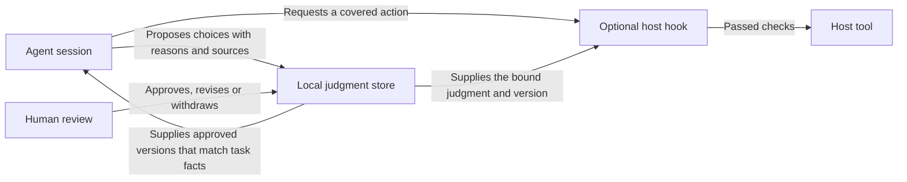

<p align="center">
  
</p>

# Proofpress

**Your judgment. Built into your agents.**

Everything is recorded. Your agent still repeats the same mistakes.
Proofpress helps carry your guidance and agent experience into later work—as
judgments you can review, reuse and update.

**The open-source judgment layer for agents.**
[Website](https://proofpress.dev) · [Quick start](#quick-start) ·
[Agent instructions](docs/AGENT-SETUP.md) · [Documentation](#documentation)

## What is a judgment?

A choice worth carrying forward, with its reasons and boundaries. For example:

> **Cache search results. Recheck file access.**
> **Why:** Older results are acceptable. Exposing private files is not.
> **When:** Public results and previews.
> **Excludes:** Private content and access checks.

A judgment can shape one task or guide a project over time. Keep the choice,
the tradeoff behind it and the conditions that would change it. Both you and
an agent can propose judgments. If search starts powering urgent alerts, the
tradeoff changes. **Cache public results. Keep urgent alerts live.**

## Quick start

Run your agent's command from the project where you work. Requires macOS or
Linux and Git. The installer sets up Python, Proofpress, the project's
`.judgment/` store and the guidance for your agent. [Installation details](docs/INSTALL.md)

### Codex

```sh
curl -fsSL https://raw.githubusercontent.com/continuara-lab/proofpress-judgment/main/install.sh | bash -s -- --agents codex
```

### Claude Code

```sh
curl -fsSL https://raw.githubusercontent.com/continuara-lab/proofpress-judgment/main/install.sh | bash -s -- --agents claude-code
```

### Cursor

```sh
curl -fsSL https://raw.githubusercontent.com/continuara-lab/proofpress-judgment/main/install.sh | bash -s -- --agents cursor
```

Start a fresh session in the project and give your agent a task. The project
instructions tell it when to look up approved judgments and propose new ones.
[Commands for other agents](docs/AGENTS.md#install-by-agent)

When your agent proposes a judgment, review it in your terminal:

```sh
proofpress review
```

Choose a candidate from the numbered inbox. Read it, edit it if needed, then approve
or reject it. **You approve before reuse.** Capture is agent guidance, not an
automatic listener for every message.

## Architecture



Proofpress stores AJF records, review decisions and reuse receipts in the project's
SQLite database. Agents consult it through the CLI. The human owns admission and
chooses which actions need an enforcement hook. [Records](docs/AJF.md) · [Runtime](docs/RUNTIME.md)

## The everyday loop

| Step | What you do |
| --- | --- |
| **Capture & review** | Keep a useful judgment, check its basis and choose where it applies. |
| **Reuse** | Supply approved, current judgments to later tasks whose conditions match. |
| **Learn** | Attach outcome observations to the exact version for later inspection. |
| **Update** | Revise or withdraw guidance as evidence and conditions change. |

```sh
proofpress configure     # Choose what the agent may propose
proofpress edit ID       # Edit in your preferred editor; creates a new candidate
proofpress withdraw ID   # Stop an admitted judgment from being reused
proofpress doctor        # Inspect skills, hooks and active bindings
```

Sources, versions and review history stay inspectable. An edit needs fresh review.
Reuse currently matches explicit scopes and factual conditions.
[Full walkthrough](docs/LOCAL-ALPHA.md)

<details>
<summary><strong>Import a project's past Codex sessions</strong></summary>

```sh
proofpress history project --project /path/to/project --days 7
proofpress consolidate --scope coding --model-assessment --all
proofpress review
```

Import asks before storing redacted excerpts locally. Extraction sends those
excerpts to Codex and follows your capture settings. It produces candidates for
review. Redaction may miss sensitive details. [History guide](docs/INTAKE.md)

</details>

<details>
<summary><strong>Enforce a judgment with a hook</strong></summary>

Choose **Enforcement** during review to inspect and approve the proposed protection
together with the judgment. Select your host when installing the hook.

```sh
proofpress hooks install --host codex             # Preview
proofpress hooks install --host codex --confirm   # Install
```

Use `--host claude-code` or `--host cursor` for those agents. Follow the host’s
trust and hook review flow after restarting it. Supported checks
cover protected paths, lifecycle/conditions and optional decision model assessment.
Shell, MCP and unsupported routes pause while bindings are active. These are
cooperative local hooks; host trust and tool coverage matter.
[Enforcement and recovery](docs/RUNTIME.md)

</details>

## Documentation

[Installation](docs/INSTALL.md) · [Agent setup](docs/AGENT-SETUP.md) ·
[CLI reference](docs/CLI.md) · [AJF records](docs/AJF.md) ·
[Evaluation](evals/README.md) · [Contributing](CONTRIBUTING.md) ·
[Security](SECURITY.md) · [License](LICENSE)

For agents: read the installed `proofpress` skill for this project's workspace
and capture settings. Use `--format agent` for compact output; `--json` expands
full records. Agents propose and retrieve; humans control admission and enforcement.

This repository develops the personal CLI. The [public Proofpress repository](https://github.com/chenmingtang830/proofpress)
contains the existing MCP/server implementation and research. Their installation
commands and stores differ. [Repository map](docs/REPOSITORIES.md)
