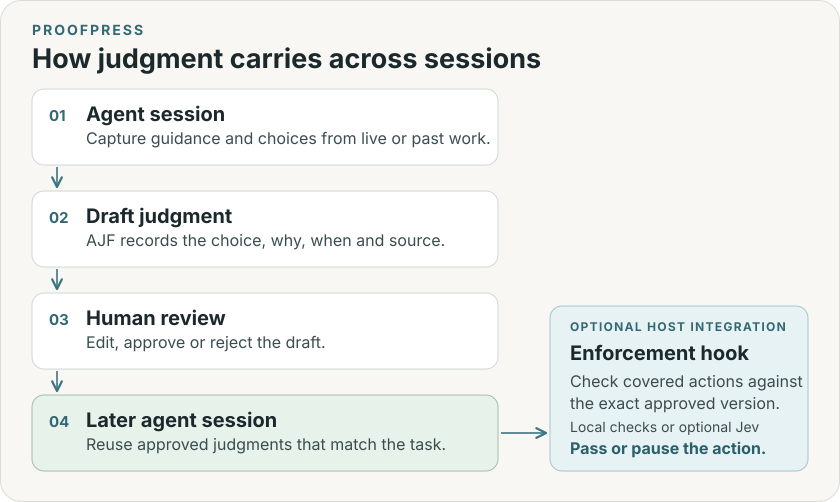

<p align="center">
  
</p>

# Proofpress

**Your judgment. Built into your agents.**

Everything is recorded. Your agent still repeats the same mistakes.
Proofpress helps carry your guidance and agent experience into later work—as
judgments you can review, reuse and update.

**The open-source judgment layer for agents.**
[Website](https://proofpress.dev) · [Quick start](#quick-start) ·
[Import past sessions](#import-past-sessions) · [Enforcement](#enforce-judgments) · [Docs](#documentation)

## What is a judgment?

A choice worth carrying forward, with its reasons and boundaries. For example:

> **Cache search results. Recheck file access.**
> **Why:** Older results are acceptable. Exposing private files is not.
> **When:** Public results and previews.
> **Excludes:** Private content and access checks.

A judgment can shape one task or guide a project over time. Keep the choice,
the tradeoff behind it and the conditions that would change it. Both you and
an agent can propose judgments. If search starts powering urgent alerts, the
tradeoff changes. **Cache public results. Keep urgent alerts live.**

## Quick start

Run your agent's command from the project where you work. Requires macOS or
Linux and Git. The installer sets up Python, Proofpress, the project's
`.judgment/` store and the guidance for your agent. [Installation details](docs/INSTALL.md)

### Codex

```sh
curl -fsSL https://raw.githubusercontent.com/continuara-lab/proofpress-judgment/main/install.sh | bash -s -- --agents codex
```

### Claude Code

```sh
curl -fsSL https://raw.githubusercontent.com/continuara-lab/proofpress-judgment/main/install.sh | bash -s -- --agents claude-code
```

### Cursor

```sh
curl -fsSL https://raw.githubusercontent.com/continuara-lab/proofpress-judgment/main/install.sh | bash -s -- --agents cursor
```

The installer shows the project policy. Use it as shown or customize what the
agent may propose. Start a fresh session in the project and give your agent a task. The project
instructions tell it when to look up approved judgments and propose new ones.
[Commands for other agents](docs/AGENTS.md#install-by-agent)

When your agent proposes a judgment, review it in your terminal:

```sh
proofpress review
```

Choose a candidate from the numbered inbox. Read it, edit it if needed, then approve
or reject it. **You approve before reuse.** Capture is agent guidance, not an
automatic listener for every message.

## How it works



An agent proposes a judgment from work in a session. You review it once. Later
sessions can look up the current approved version when the scope and conditions
match. You can record outcomes and revise or withdraw guidance as conditions change.
[Architecture and storage](docs/ARCHITECTURE.md)

### Three checks in the workflow

| Step | What Proofpress checks | Who decides |
| --- | --- | --- |
| **Admission review** | Local checks flag invalid or conflicting candidates. Optional Jev advice checks whether the evidence and scope meet your review policy. | You approve the exact revision. |
| **Retrieval** | SQLite stores the records. The CLI filters approved versions by exact scope, task facts, validity and dependencies. | The agent receives eligible guidance for the task. |
| **Tool enforcement** | An optional pre-tool hook checks a covered action against a specific approved version and binding. | The hook can pause the action. The host retains its own permissions. |

[Configure model review](docs/INTAKE.md#review-policy) · [How retrieval works](docs/ARCHITECTURE.md#how-retrieval-works) · [Enforcement](#enforce-judgments)

## Agent Judgment Format (AJF)

AJF is the portable JSON format for a judgment. It captures **what you chose,
why, when it applies, and where it came from**. Proofpress keeps approvals and
hook bindings separately in the project's local store, tied to the exact version.

[Format guide](docs/AJF.md) · [JSON schema](src/judgment_layer/ajf.schema.json) ·
[Example record](examples/contextual-judgment.json)

## Import past sessions

Run the command for the agent whose local history you want to import. Each
command previews the last seven days and asks before saving excerpts locally.

**Codex**

```sh
proofpress history project --project . --agent codex
```

**Claude Code**

```sh
proofpress history project --project . --agent claude-code
```

**Cursor**

```sh
proofpress history project --project . --agent cursor
```

To turn the imported excerpts into candidates, use the separate extraction step.

```sh
proofpress consolidate --scope coding --model-assessment --all
proofpress review
```

Extraction sends excerpts to Codex, including when the source is Claude Code or
Cursor. Redaction is best effort. [Supported transcripts and import guide](docs/INTAKE.md)

## Enforce judgments

Use hooks when a judgment should pause a covered tool action. In
`proofpress review`, choose **Enforcement** and review the paths and check
alongside the judgment. One approval binds both to the exact revision.

Run the command for your agent from the project you want to protect.

**Codex**

```sh
proofpress hooks install --host codex --confirm
```

**Claude Code**

```sh
proofpress hooks install --host claude-code --confirm
```

**Cursor**

```sh
proofpress hooks install --host cursor --confirm
```

Restart the agent and complete its project and hook trust flow. Run
`proofpress doctor` to inspect configuration and the last observed check.
[Tool coverage and recovery](docs/RUNTIME.md)

### Optional Jev checks — bring your own key

**Bring your own TypeSafe API key** to use Jev for judgments that need
interpretation of meaning, context or exceptions.

- **Review a candidate.** Assess whether its evidence and scope meet your project's review criteria, then give you an approval recommendation.
- **Check for conflicts.** Assess whether a proposed judgment contradicts approved guidance under overlapping conditions.

For example, “cache all search results” needs review if approved guidance
requires urgent alerts to use live data. Jev can assess that overlap and
recommend narrowing the judgment.

You decide which judgments to admit. Local path and condition checks work
without a key.
[Set up Jev](docs/RUNTIME.md#set-up-jev) · [Supported hook checks](docs/RUNTIME.md#what-the-hook-checks) · [Environment template](.env.example)

## Documentation

[Installation](docs/INSTALL.md) · [Agent setup](docs/AGENT-SETUP.md) ·
[CLI reference](docs/CLI.md) · [Architecture](docs/ARCHITECTURE.md) · [AJF](docs/AJF.md) ·
[Local walkthrough](docs/LOCAL-ALPHA.md) · [Evaluation](evals/README.md) · [Contributing](CONTRIBUTING.md) ·
[Security](SECURITY.md) · [License](LICENSE)

For agents: read the installed `proofpress` skill for this project's workspace
and capture settings. Use `--format agent` for compact output; `--json` expands
full records. Agents propose and retrieve; humans control admission and enforcement.

This repository develops the personal CLI. The [public Proofpress repository](https://github.com/chenmingtang830/proofpress)
contains the existing MCP/server implementation and research. Their installation
commands and stores differ. [Repository map](docs/REPOSITORIES.md)
