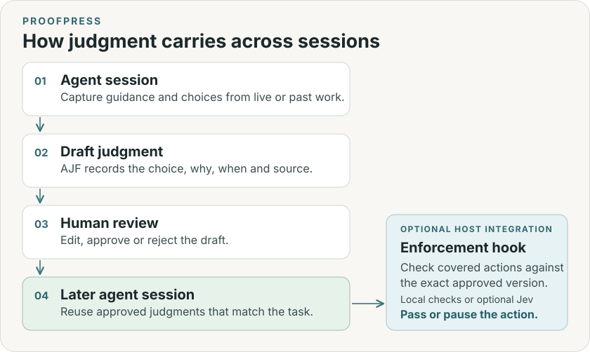

# How Proofpress works

1. **Agent session.** Your project guidance tells the agent when to propose useful
   judgments. You can also import selected local transcripts from Codex, Claude
   Code or Cursor and extract candidates separately.
2. **Draft judgment.** The [Agent Judgment Format](AJF.md) records the choice,
   rationale, original situation, applicability and source.
3. **Human review.** Edit, approve or reject the exact revision. For covered
   actions, review an optional enforcement binding alongside the judgment.
4. **Later agent session.** The CLI supplies current approved judgments whose
   scopes, conditions, validity and dependencies match. A separately installed
   host hook checks bound actions before they execute.

[Import past sessions](INTAKE.md) · [Enforce judgments](RUNTIME.md)

## What lives in the project

Proofpress is a Python CLI with a project-local SQLite store in `.judgment/`.
The store contains immutable AJF revisions, governance events, enforcement
bindings, context receipts, outcome observations and any imported excerpts.
Review authority stays in the local store when AJF is exported.

The journal binds events to exact content digests. Store transactions verify
integrity and serialize updates with `BEGIN IMMEDIATE`. Review binds the
inspected revision. Admission and predecessor supersession commit together.
A pending revision leaves the previous admission active. Withdrawing a
revision does not revive an older one. Dependencies stay pinned to their
approved versions.

## How retrieval works

Agents call `proofpress context` with an exact scope and known task facts.
The current CLI reads SQLite revisions and filters in Python. It keeps admitted,
applicable versions whose conditions, validity window and pinned dependencies
match. A recorded conflict or unresolved scope hold can suppress those matches.
Use `proofpress match` to see inclusion and exclusion reasons. The caller
supplies the scope and facts. This path makes no model call.

## Advice and enforcement

A context receipt records which versions and facts the CLI supplied. Use
`proofpress check` to re-evaluate it against current state. Outcome observations
append to a revision without changing it. A receipt measures context supplied;
an outcome observation records what was observed.

An enforcement binding pins a verifier and covered actions to an admitted
revision. When the installed host emits a covered action, the hook checks the
binding and returns pass or pause. Stale, withdrawn and superseded bindings
pause until a human resolves them. Host trust, tool coverage and check timing
define the limits of local enforcement.
[Runtime details](RUNTIME.md) · [Security boundaries](../SECURITY.md)

## Optional decision model

Proofpress checks structured assertions, scope, conditions and versions locally.
Jev, called through TypeSafe, supports three opt-in checks:

| Entry point | What Jev receives | What Proofpress does with the result |
| --- | --- | --- |
| Admission advice | The candidate, project review criteria, and optionally referenced history excerpts | Recommends approval, revision, or human judgment. Advice is scoped to the candidate and review policy versions. |
| Conflict assessment | The proposed judgment and overlapping approved judgments | Flags a potential conflict or uncertainty for review |
| Bound output check | The approved judgment and complete proposed new-file content | Pauses a covered write on a violation, uncertainty or provider failure |

Human review controls admission and binding. A model pass on a write leaves the
host's own permissions in effect. [Set up Jev](RUNTIME.md#set-up-jev)

## Install and integrate

[The installer](INSTALL.md) sets up the CLI, store and project-local guidance.
Codex, Claude Code and Cursor can load the guidance at startup. Other supported
hosts can load the skill through their entry points. Hook installation and
history import are separate steps.

[Supported agents](AGENTS.md) · [CLI commands](CLI.md)
