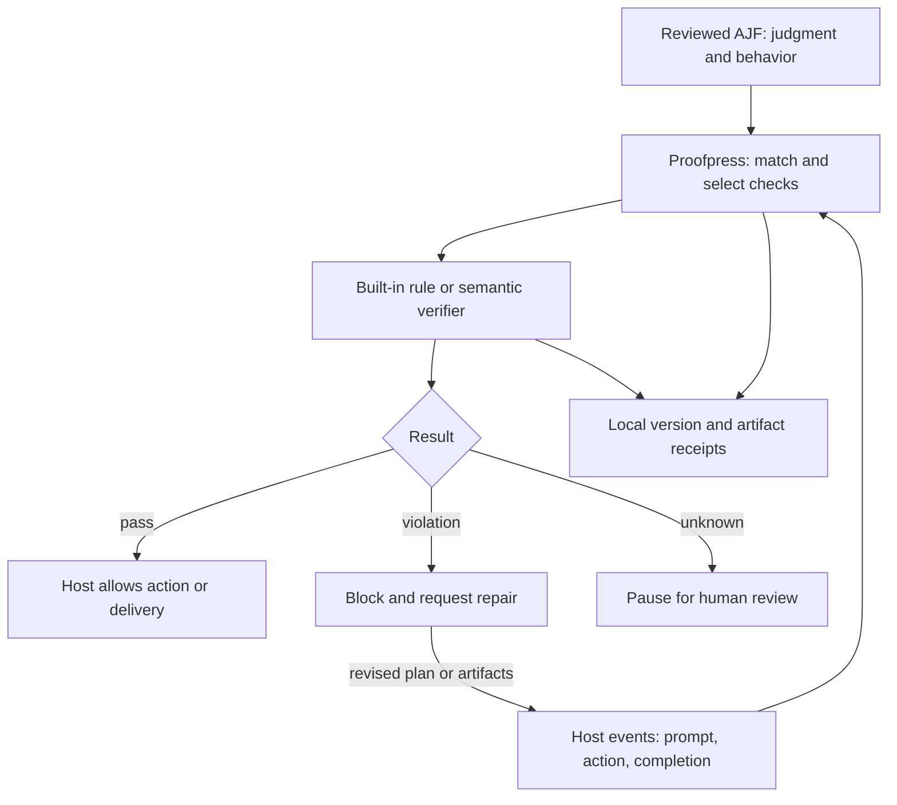

# Judgment-owned behavior

A judgment is one AJF JSON document containing its rationale, scope, conditions
and optional behavior. Most need no code bundle. A hook declares when to check;
a verifier declares how to check. This release supports built-in action rules and
semantic plan/delivery checks. Custom verifier programs are not supported and are
rejected, rather than silently ignored. [Complete example](../examples/behavior-judgment.json)

## Start with a judgment

```sh
proofpress example --behavior > judgment.json
# Adapt source attribution, scope, conditions, criteria and file paths to the project.
proofpress capture --from judgment.json
proofpress review
proofpress enforce install --host claude-code
proofpress enforce install --host claude-code --confirm
```

Capture is candidate-only. The review shows task criteria, context, action paths,
verifiers, artifact coverage and failure handling alongside the rationale.
Approval covers that exact revision. `proofpress edit ID` edits these fields as
part of a new candidate; no separate workflow or binding is needed. A simple
advice judgment may omit behavior entirely. Existing records do not acquire
checks automatically.

The workspace is project-local; its connection supplies the canonical project
root. All admitted behavior-bearing judgments in that workspace are considered,
across their explicit scope namespaces. If `applicability.task_criteria` is absent,
known matching conditions suffice for task inclusion. If present, the configured
model assesses those criteria. No top-k search decides which candidates exist.
Unknown recognition or missing facts pauses execution. Semantic false negatives
remain possible. An action declaration with `scope_and_conditions` remains active
regardless of the task recognizer's result.

Project facts are optional connection settings, not a task workflow:

```sh
proofpress enforce install --host claude-code --facts facts.json --confirm
```

Use observed/reviewed facts; they are not inferred by Jev. Omitting `--facts`
preserves current settings. Fact or admitted-behavior changes invalidate existing
task approvals and require fresh preparation. A pending candidate does not alter
active behavior. Withdrawal deactivates embedded behavior for future tasks and
invalidates existing approvals; old revisions do not reappear. Legacy local
bindings retain their own explicit-unbind behavior.

## What the JSON means

```json
{
  "event": "before_action",
  "activation": "scope_and_conditions",
  "match": {"action": "direct_file_edit", "paths": ["src/generated/*"]},
  "verifier": {
    "type": "builtin", "name": "deny_action", "version": 1,
    "message": "Modify the source schema and regenerate."
  }
}
```

This is declarative data, not executable Python. On a matching direct edit,
Proofpress runs its installed `deny_action` implementation and returns a denial.
`require_conditions` checks applicability/lifecycle only; it does not verify
output quality. Versions other than 1 are rejected. `semantic` verifiers instead
carry explicit criteria for the plan or actual delivery artifacts. All requested
criteria at a stage are assessed together. Passing one does not waive another.

`before_delivery` requires `behavior.artifacts` with path patterns and exact
required filenames. Review reads actual covered text files, including newly
created files and deletion markers from the preparation baseline. It does not
trust the agent to choose a passing subset. Files larger than 64 KB, unsafe paths,
symlinks, missing required files and model packet limits pause review. Private
integration directories, `.env*`, `.git`, `.venv`, `node_modules` and `__pycache__`
are excluded. This is declared artifact coverage, not a full repository or trace
audit. Validate that the declared coverage is sufficient during human review.

## Runtime architecture



The host is connected once; adding a judgment does not register another host
hook. The existing host entry can receive every supported tool event. Known
reads return without a model call. Direct edits use path/action conditions and
built-in rules, while semantic work is confined to optional task recognition and
declared plan/delivery boundaries. Two aggregate model calls cover plan and
output when both are requested and no recognition/retry calls are needed.

A `task` is an internal run record, not a user-authored workflow definition. It
tracks the exact supplied judgments, plan result and artifact revision. Empty
selection and unrequested checks are explicitly labeled; a model is not called
and no semantic-verification claim should be made for those boundaries.

## Host coverage

| Host | Context and plan | Action checks | Completion |
| --- | --- | --- | --- |
| Claude Code | Prompt bridge supplies context; only declared plan checks run | Native PreToolUse; file tools and patch targets | Stop reviews declared files and actual final response; repair or pause |
| Codex | Native UserPromptSubmit prepares/attaches automatically and supplies context | Native PreToolUse, including patch targets | Native Stop reviews actual files/response; one repair continuation retains the same task |
| Cursor | beforeSubmitPrompt prepares/attaches automatically; first preToolUse is denied once with the context packet before tools execute | Native preToolUse with normalized edit/write routes | afterAgentResponse captures actual text; stop automatically reviews files/text and can request one follow-up |

Install with `proofpress enforce install --host HOST --confirm`. The installer
preserves user hooks and upgrades an unchanged managed action-only entry without
leaving duplicate registrations. `doctor` lists each lifecycle connection;
`enforce remove --host HOST --confirm` and `uninstall` remove only owned entries.
New/changed hooks still require the host's trust flow.

Codex Stop continuation is a new prompt. A task-bound resume marker keeps the
original judgment/context/check state across that prompt. Host turn ids prevent
a delayed response from approving another turn. Cursor uses conversation plus
generation ids: response text from an earlier generation cannot satisfy the
current completion check. Unknown, missing/corrupt response, aborted/error status
or repeated failure leaves delivery unapproved. A handoff response is not treated
as new compliance evidence and does not trigger another semantic review loop.

**Cursor completion is post-response review, not a pre-display veto.** Its public
stop contract supports a follow-up message, not blocking or retracting rendered
text. The adapter does not invent a deny field for stop. One bounded repair or
human-handoff follow-up is available; exact-artifact export remains a separate
hard check. Cursor cannot inject per-task context from beforeSubmitPrompt, so
context is supplied before the first tool rather than before the first model
reasoning step. A task that uses no tools is still automatically checked on stop.

The new adapters have protocol/subprocess tests. The
[validation record](verification/native-completion-protocol-2026-11-20.json) notes
that Codex 0.169.0 could not initialize in this environment (read-only filesystem)
and no Cursor client was available. Host-specific live verification remains pending; a protocol fixture is not a real-client receipt or an
assessment-quality result. Claude registration requires its documented hook
version. Cursor CLI/editor hook availability depends on the installed host; if
the necessary events do not fire, no completed review should be inferred.

Wire references checked for this implementation:
[Codex hooks](https://learn.chatgpt.com/docs/hooks) and
[Cursor hooks](https://cursor.com/docs/hooks). Neither surface can retract
already streamed text or gate an earlier external side effect.

Unknown shell/MCP routes pause conservatively. The only shell exception is the
narrow task-plan/status/finish control channel for the same task/workspace.
Arbitrary generator, test and build commands need a separate covered adapter;
this release does not claim those effects are protected. A denial cannot undo an
earlier side effect. Stop cannot retract streamed text. External send/deploy/
publish needs its own pre-action integration. Same-user local controls remain
cooperative, not an OS security boundary.

## Codex and Cursor

Connect the actual host once, then start a new session and review/trust the hooks:

```sh
proofpress enforce install --host codex --confirm
# Or, in a Cursor project:
proofpress enforce install --host cursor --confirm
proofpress doctor
```

The native prompt/action/completion events prepare and attach the task and review
completion automatically. No workflow configuration, manual session id or
mandatory `task-finish-files` call is needed in this path. A declared plan still
requires the agent to submit the concrete plan through the supplied command;
covered source execution stays paused until that plan passes.

Explicit `task-prepare`, `task-attach`, `task-finish-files` and `task-export` remain
available for custom callers or exact reviewed local file bundles. These commands
are an integration API, not prerequisites for ordinary native completion.
`task-export` writes a local reviewed bundle, not an external deployment. Native
completion checks cover files plus response; a separate file-only export uses a
file-only review of that exact bundle.

## Pauses, repair and review

Run `proofpress task-status --task TASK` to see the paused boundary, checked
judgments, reason, review file and next actions. Violation means a check flagged
a problem; unknown means insufficient evidence, missing facts or unavailable
assessment. Neither approves delivery.

Failed plan checks pause source execution. Failed delivery checks permit repairs
after a current plan, while action constraints remain active. Changed artifacts
or later source writes invalidate old delivery approval. On native Stop, a
violation permits one repair continuation; repeated failure or unknown returns
control to the human without approval. An unchanged failed bundle is not
silently resubmitted to the model.

If all selected delivery judgments explicitly allow exceptions, a human can
review the exact stored artifact bundle and confirm a one-off exception with
`task-exception`. It cannot waive withdrawn/stale judgments, approve another
artifact revision or change the judgment permanently. Otherwise revise the
judgment through a new review, or repair and recheck. Agents cannot approve
judgments, change host policy, or grant themselves exceptions.
